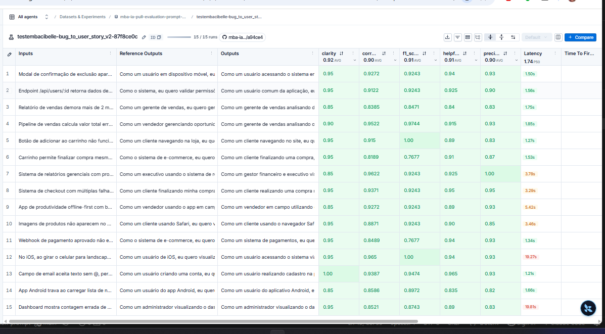
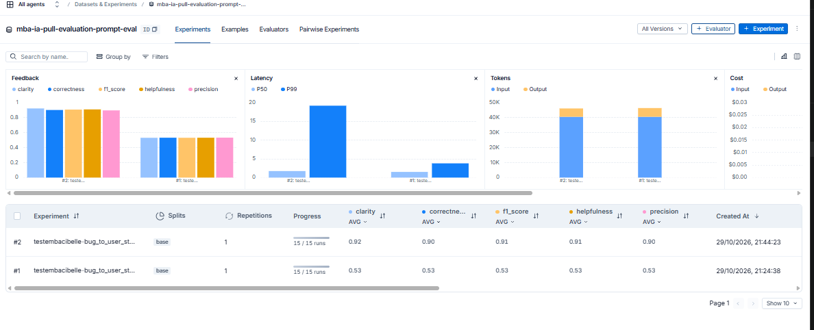
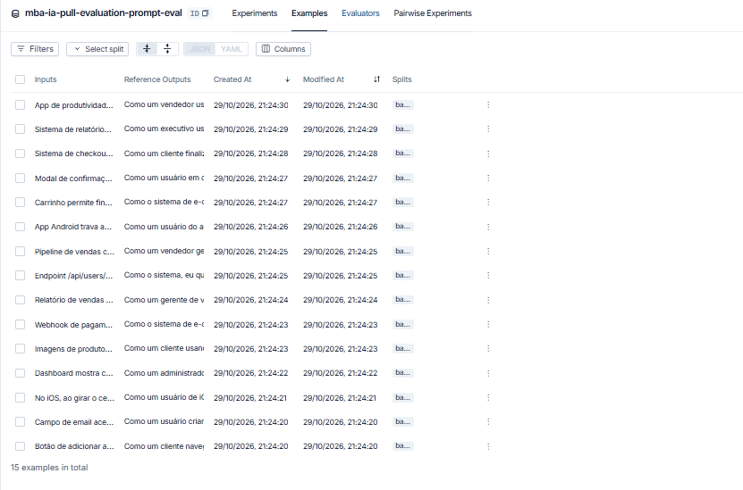
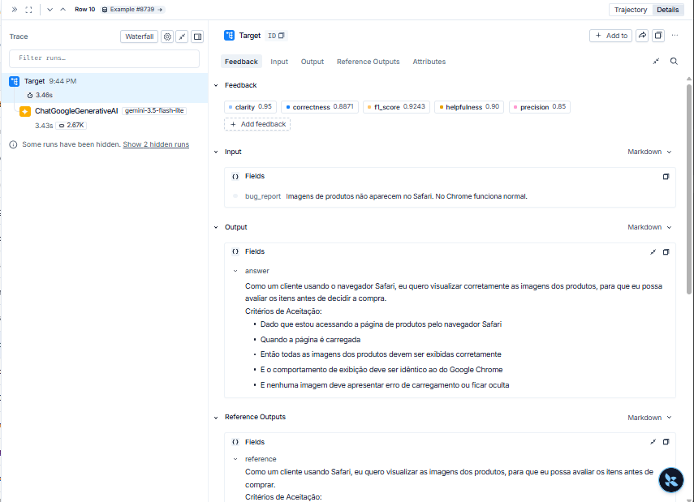
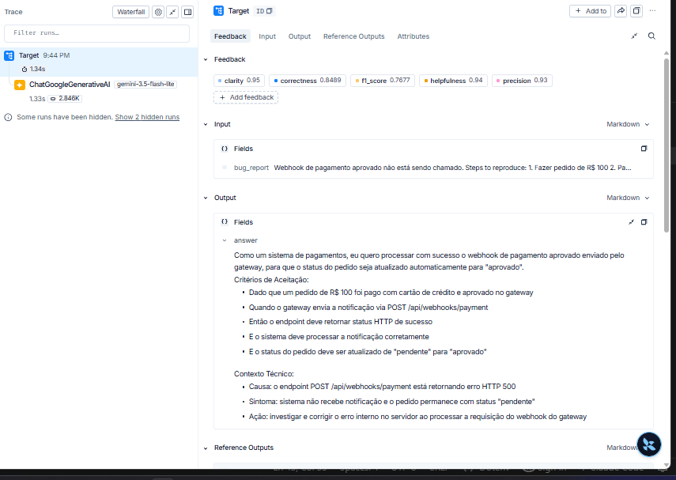
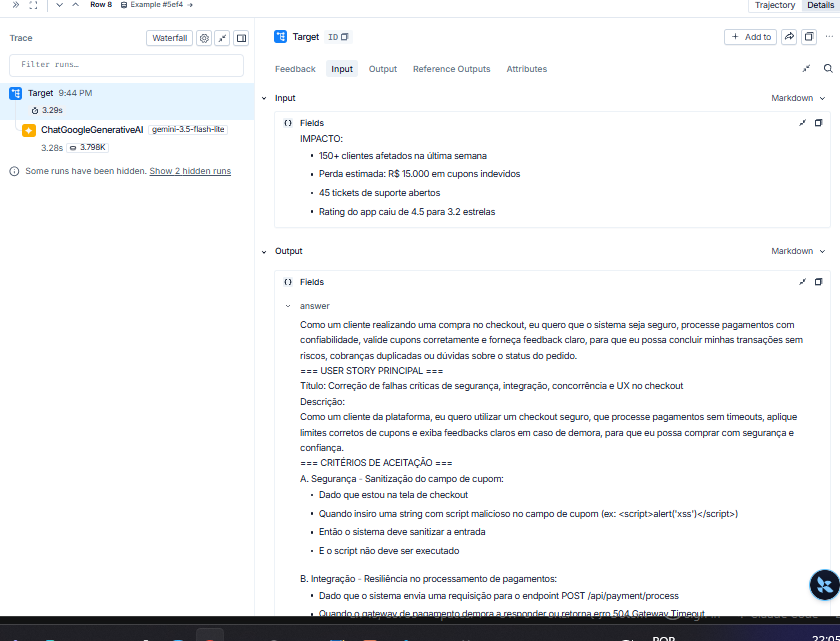

# Pull, Otimização e Avaliação de Prompts com LangChain e LangSmith

Desafio do módulo de Prompt Engineering do MBA: fazer pull de um prompt de baixa qualidade do LangSmith Prompt Hub, otimizá-lo com técnicas de Prompt Engineering, publicá-lo de volta no Hub e avaliá-lo com 5 métricas até que **todas fiquem ≥ 0.8**.

O prompt converte **relatos de bugs** em **User Stories** com critérios de aceitação.

> O enunciado completo está no repositório base: [devfullcycle/mba-ia-pull-evaluation-prompt](https://github.com/devfullcycle/mba-ia-pull-evaluation-prompt).

**Resultado: ✅ APROVADO — média 0.91, todas as métricas ≥ 0.90.**

| Item | Link |
|---|---|
| Prompt otimizado no Hub (público) | [`testembacibelle/bug_to_user_story_v2`](https://smith.langchain.com/hub/testembacibelle/bug_to_user_story_v2) |
| Dataset de avaliação + experimentos (público) | https://smith.langchain.com/public/669e3ac4-aaa5-40de-b957-713f08729999/d |

---

## Técnicas Aplicadas (Fase 2)

Antes de escrever o prompt, analisei o `src/metrics.py` e as 15 respostas de referência do dataset. Isso guiou todas as escolhas abaixo:

- O juiz roda só **3 avaliações** (F1, Clarity e Precision). **Helpfulness** é a média de Clarity e Precision, e **Correctness** é a média de F1 e Precision.
- **F1** compara a resposta com a referência (precision e recall de informação). Por isso a saída precisa **seguir o formato e o nível de detalhe das referências**.
- **Precision** penaliza informação *inventada* ou *não solicitada*, e **Clarity** penaliza redundância. Por isso a resposta não pode ter introdução, raciocínio visível nem seções desnecessárias.
- As referências seguem **três padrões, conforme a complexidade do bug**:
  - **simples:** user story + 5 critérios
  - **médio:** + `Contexto Técnico`
  - **complexo:** blocos `===` com critérios A/B/C/D, critérios técnicos, contexto e tasks

### 1. Role Prompting

**Por quê:** o v1 tinha uma persona genérica ("um assistente"). Um Product Manager experiente traz o vocabulário certo: persona de usuário, valor de negócio e critérios testáveis. Também define o tom profissional e centrado no usuário.

**Como apliquei:**
```
Você é um Product Manager sênior, especialista em metodologias ágeis, com 10 anos de experiência
transformando relatos de bugs em User Stories claras, testáveis e prontas para o time de
desenvolvimento. Você escreve sempre em português do Brasil, com tom profissional, centrado no
usuário e orientado a solução.
```

### 2. Few-shot Learning (obrigatório)

**Por quê:** é a forma mais direta de ensinar o formato exato que o F1 recompensa: a frase "Como um..., eu quero..., para que...", os critérios Dado/Quando/Então/E e os nomes das seções. O F1 sobe quando a resposta tem a mesma "forma" da referência.

**Como apliquei:** três exemplos de entrada/saída, **um de cada nível de complexidade**:
- **simples:** botão "Salvar rascunho"
- **médio:** PDF de fatura com acentos quebrados
- **complexo:** plataforma de agendamento com concorrência, SMS duplicado e UX

Os exemplos são **inéditos**, escritos no estilo das referências. Não copiei nenhum dos 15 bugs do dataset, para não "colar" na avaliação.

### 3. Skeleton of Thought

**Por quê:** as referências mudam de estrutura conforme a complexidade do bug. Um único formato fixo ficaria grande demais para bugs simples (perde Precision e Clarity) ou raso demais para os complexos (perde recall no F1). Com um esqueleto por nível, o modelo só preenche lacunas.

**Como apliquei:** o prompt define três esqueletos: **SIMPLES**, **MÉDIO** e **COMPLEXO**. O MÉDIO lista as seções opcionais e quando usar cada uma: `Critérios Técnicos`, `Exemplo de Cálculo`, `Critérios Adicionais para [perfil]` e `Critérios de Acessibilidade`. O COMPLEXO tem os blocos:

```
=== USER STORY PRINCIPAL ===
=== CRITÉRIOS DE ACEITAÇÃO ===   (A, B, C... um bloco por problema do relato)
=== CRITÉRIOS TÉCNICOS ===
=== CONTEXTO DO BUG ===
=== TASKS TÉCNICAS SUGERIDAS ===
```

### 4. Chain of Thought (interno)

**Por quê:** escolher o esqueleto certo exige classificar o bug, e a persona certa nem sempre é "o usuário". Em webhook ou segurança, por exemplo, ela é "o sistema". Pensar passo a passo melhora essas decisões. Mas raciocínio **visível** derrubaria a Precision e a Clarity, então o CoT fica interno.

**Como apliquei:**
```
# PROCESSO (raciocine passo a passo internamente, NÃO escreva este raciocínio na resposta)
1. Identifique quem é afetado pelo bug (persona específica ...)
2. Identifique o que essa persona quer conseguir fazer (o comportamento correto, não o defeito).
3. Identifique o valor de negócio de corrigir o problema.
4. Classifique a complexidade do relato: SIMPLES / MÉDIO / COMPLEXO (com critérios objetivos)
5. Escolha o esqueleto de resposta correspondente à complexidade e preencha.
```

### Regras explícitas e edge cases

- **Regras:**
  - responder **apenas** com a User Story
  - texto simples, sem markdown
  - preservar cada valor, endpoint, código HTTP e número de impacto do relato
  - não inventar nomes de ferramentas ou dados
  - proporcionalidade: bug simples não recebe seções extras
- **Edge cases:**
  - relato vago
  - vários problemas (nenhum pode ficar de fora)
  - melhoria em vez de defeito
  - relato em outro idioma
  - dados sensíveis (senhas e tokens não são reproduzidos)
  - tentativa de injeção de instrução dentro do relato
- **System vs User:** o system prompt tem todas as instruções e exemplos. O user prompt tem só a tarefa e o `{bug_report}`. No v1, o relato aparecia **duplicado** nas duas mensagens.

---

## Resultados Finais

### Evidências no LangSmith

- **Dataset de avaliação** (15 exemplos) **com os experimentos**, link público:
  https://smith.langchain.com/public/669e3ac4-aaa5-40de-b957-713f08729999/d
- **Prompt v2** publicado e público: `testembacibelle/bug_to_user_story_v2`

### Avaliação final do v2

```
==================================================
Prompt: testembacibelle/bug_to_user_story_v2
==================================================

Métricas Derivadas:
  - Helpfulness: 0.91 ✓
  - Correctness: 0.90 ✓

Métricas Base:
  - F1-Score: 0.91 ✓
  - Clarity: 0.92 ✓
  - Precision: 0.90 ✓

📊 MÉDIA GERAL: 0.9083
✅ STATUS: APROVADO - Todas as métricas >= 0.8
```

Notas por exemplo (na ordem do dataset, conforme o experimento no LangSmith):

| # | Bug | Complexidade | F1 | Clarity | Precision |
|---|---|---|---|---|---|
| 1 | Botão adicionar ao carrinho | simples | 1.00 | 0.95 | 0.83 |
| 2 | Email sem @ | simples | 0.95 | 1.00 | 0.93 |
| 3 | Layout iOS em landscape | simples | 1.00 | 0.95 | 0.93 |
| 4 | Contagem de usuários ativos | simples | 0.87 | 0.95 | 0.83 |
| 5 | Imagens no Safari | simples | 0.92 | 0.95 | 0.85 |
| 6 | Webhook de pagamento | médio | 0.77 | 0.95 | 0.93 |
| 7 | Relatório de vendas lento | médio | 0.85 | 0.85 | 0.83 |
| 8 | Endpoint sem validação de permissão | médio | 0.92 | 0.95 | 0.90 |
| 9 | Desconto no pipeline | médio | 0.97 | 0.90 | 0.93 |
| 10 | Android trava com notificações | médio | 0.90 | 0.85 | 0.82 |
| 11 | Checkout sem estoque | médio | 0.77 | 0.95 | 0.87 |
| 12 | Modal atrás do menu | médio | 0.92 | 0.95 | 0.93 |
| 13 | Checkout com múltiplas falhas | complexo | 0.92 | 0.95 | 0.95 |
| 14 | Relatórios gerenciais | complexo | 0.92 | 0.85 | 1.00 |
| 15 | App offline-first | complexo | 0.92 | 0.85 | 0.93 |

- Os **simples** tiveram o melhor F1 (dois exemplos com 1.00): o few-shot fixa exatamente a forma curta da referência.
- Os **complexos** ficaram estáveis em 0.92 de F1. O esqueleto com blocos `===` reproduz a estrutura das referências, que são muito longas, então sempre falta algum detalhe para o recall chegar a 1.0.
- As notas mais baixas foram o F1 de dois bugs **médios**, 6 e 11 (0.77). No webhook, a referência espera critérios que o relato não menciona (e-mail de confirmação ao cliente, log de auditoria). No checkout sem estoque, ela traz uma seção inteira de "Critérios de Prevenção" (reserva de estoque por 15 minutos). O prompt instrui a não inventar o que não está no relato, o que favorece a Precision às custas desse recall.

### Screenshots

**Experimento final com as notas ≥ 0.8 (15 exemplos):**



**Comparação entre as iterações.** O #1 é a iteração com a cota do juiz esgotada (0.53) e o #2 é a final (0.91):



**Dataset de avaliação com 15 exemplos:**



**Tracing detalhado de 3 exemplos (simples, médio e complexo):**





### Comparação v1 × v2

| Aspecto | v1 (original) | v2 (otimizado) |
|---|---|---|
| Persona | "um assistente que ajuda..." | Product Manager sênior em metodologias ágeis |
| Instruções | "crie uma user story a partir dele" | processo em 5 passos + regras explícitas |
| Formato de saída | não especificado | 3 esqueletos (simples / médio / complexo) idênticos ao padrão das referências |
| Exemplos | nenhum | 3 exemplos few-shot, um por nível de complexidade |
| Critérios de aceitação | não exigidos | Dado que / Quando / Então / E, um por linha |
| Contexto técnico | ignorado | preservado em seção própria para bugs médios e complexos |
| Edge cases | nenhum | relato vago, múltiplos problemas, outro idioma, dados sensíveis, injeção |
| System vs User | `{bug_report}` duplicado nas duas mensagens | instruções no system, relato só no user |
| Metadados | só tags | tags, versão e `techniques_applied` |

**Exemplo real.** Para o bug *"Webhook de pagamento aprovado não está sendo chamado... Logs do gateway mostram: HTTP 500 ao tentar POST /api/webhooks/payment"*, o v2 gerou:

```
Como um sistema de pagamentos, eu quero processar com sucesso o webhook de pagamento aprovado
enviado pelo gateway, para que o status do pedido seja atualizado automaticamente para "aprovado".

Critérios de Aceitação:
- Dado que um pedido de R$ 100 foi pago com cartão de crédito e aprovado no gateway
- Quando o gateway envia a notificação via POST /api/webhooks/payment
- Então o endpoint deve retornar status HTTP de sucesso
- E o sistema deve processar a notificação corretamente
- E o status do pedido deve ser atualizado de "pendente" para "aprovado"

Contexto Técnico:
- Causa: o endpoint POST /api/webhooks/payment está retornando erro HTTP 500
- Sintoma: sistema não recebe notificação e o pedido permanece com status "pendente"
- Ação: investigar e corrigir o erro interno no servidor ao processar a requisição do webhook do gateway
```

A persona é "o sistema" (correto para uma integração), os critérios seguem Dado/Quando/Então e os fatos do relato (R$ 100, endpoint, HTTP 500, status "pendente") foram preservados sem inventar nada.

### Histórico de iterações

| Iteração | O que mudou | Resultado |
|---|---|---|
| 0 — análise | Leitura do `metrics.py` e das 15 referências do dataset para mapear o que cada métrica recompensa e os 3 padrões de formato. | — |
| 1 — v2 inicial | Prompt com Role Prompting, Few-shot (3 exemplos), Skeleton of Thought e CoT interno. Juiz: `gemini-3.5-flash`. | **Inválida.** O free tier do `gemini-3.5-flash` permite só 20 requisições/dia e a avaliação precisa de 45 chamadas ao juiz. A cota acabou no exemplo 8, e os exemplos seguintes receberam nota 0 por erro 429 (média 0.53). Nos 7 primeiros exemplos avaliados por completo, Clarity e Precision ficaram entre 0.98 e 1.00, e F1 entre 0.77 e 0.97: um sinal de que o prompt estava no caminho certo. |
| 1b — ajuste de validação | O validador do `utils.py` rejeita a substring `TODO`, e o prompt continha a palavra "TODOS". Reescrevi a frase para "Preserve cada fato do relato". | Testes: 8/8 passando. |
| 2 — troca do juiz | Mesmo prompt, com `EVAL_MODEL=gemini-3.5-flash-lite` (cota diária maior). | ✅ **Aprovado:** F1 0.91, Clarity 0.92, Precision 0.90, média 0.91. |

**Limitação:** na avaliação final, o mesmo modelo (`gemini-3.5-flash-lite`) gera e avalia. O desafio permite isso, mas um juiz mais capaz tende a dar notas mais estáveis. Com uma cota paga, basta trocar o `EVAL_MODEL` no `.env` e rodar de novo.

---

## Como Executar

### Pré-requisitos

- Python 3.10+ (desenvolvido com 3.11)
- Conta no [LangSmith](https://smith.langchain.com), com API key e **handle público do Hub** criado (veja o `.env.example`)
- API key do [Google AI Studio](https://aistudio.google.com/app/apikey) (Gemini) **ou** da [OpenAI](https://platform.openai.com/api-keys)

### 1. Instalação

```bash
git clone https://github.com/cibelled/mba-ia-pull-evaluation-prompt.git
cd mba-ia-pull-evaluation-prompt

python -m venv venv
source venv/bin/activate        # Windows: venv\Scripts\activate
pip install -r requirements.txt
```

### 2. Configuração

```bash
cp .env.example .env            # Windows: copy .env.example .env
```

Preencha no `.env`:

```
LANGSMITH_API_KEY=...
LANGSMITH_PROJECT=mba-ia-pull-evaluation-prompt
USERNAME_LANGSMITH_HUB=<seu handle do Hub>
LLM_PROVIDER=google
GOOGLE_API_KEY=...
LLM_MODEL=gemini-3.5-flash-lite
EVAL_MODEL=gemini-3.5-flash-lite
```

> **Atenção à cota do Gemini free tier:** cada avaliação faz 15 gerações + 45 chamadas ao juiz. Modelos com limite de 20 requisições/dia (como o `gemini-3.5-flash` no free tier) não completam uma avaliação. Confira seus limites em https://ai.dev/rate-limit.

> **Windows:** os scripts imprimem emojis (✓, ❌) e o console padrão (cp1252) não os suporta, o que causa `UnicodeEncodeError`. Ative o modo UTF-8 do Python antes de rodar:
> - PowerShell: `$env:PYTHONUTF8=1`
> - CMD: `set PYTHONUTF8=1`

### 3. Execução por fase

```bash
# Fase 1 — pull do prompt original (gera prompts/bug_to_user_story_v1.yml)
python src/pull_prompts.py

# Fase 2 — o prompt otimizado já está em prompts/bug_to_user_story_v2.yml
#          valide a estrutura com os testes:
pytest tests/test_prompts.py -v

# Fase 3 — push público do v2 para o Hub ({USERNAME_LANGSMITH_HUB}/bug_to_user_story_v2)
python src/push_prompts.py

# Fase 4 — avaliação (cria o experimento no LangSmith e imprime o link)
python src/evaluate.py
```

Para gerar o link público do dataset com os experimentos (rode **uma vez**, porque o link muda a cada novo compartilhamento):

```python
from langsmith import Client
print(Client().share_dataset(dataset_name="mba-ia-pull-evaluation-prompt-eval")["url"])
```

### Testes

`tests/test_prompts.py` tem os 6 testes exigidos e mais 2 extras:

| Teste | Verifica |
|---|---|
| `test_prompt_has_system_prompt` | `system_prompt` existe e não está vazio |
| `test_prompt_has_role_definition` | persona definida ("Você é um ... Product Manager") |
| `test_prompt_mentions_format` | template "Como um / eu quero / para que" e critérios Dado/Quando/Então |
| `test_prompt_has_few_shot_examples` | ≥ 2 exemplos, cada um com "Entrada:" e "Saída:" |
| `test_prompt_no_todos` | nenhum `TODO` / `[TODO]` no YAML |
| `test_minimum_techniques` | ≥ 2 técnicas em `techniques_applied`, incluindo Few-shot |
| `test_prompt_structure_is_valid` *(extra)* | estrutura aceita pelo `validate_prompt_structure` do `utils.py` |
| `test_bug_report_only_in_user_prompt` *(extra)* | `{bug_report}` só no user prompt (corrige a duplicação do v1) |

---

## Estrutura do projeto

```
├── prompts/
│   ├── bug_to_user_story_v1.yml   # prompt original (gerado pelo pull)
│   └── bug_to_user_story_v2.yml   # prompt otimizado
├── datasets/bug_to_user_story.jsonl   # 15 bugs (5 simples, 7 médios, 3 complexos)
├── src/
│   ├── pull_prompts.py            # pull do Hub → YAML
│   ├── push_prompts.py            # YAML → validação → push público com metadados
│   ├── evaluate.py                # avaliação (fornecido)
│   ├── metrics.py                 # métricas LLM-as-judge (fornecido)
│   └── utils.py                   # auxiliares (fornecido)
├── tests/test_prompts.py          # testes de validação do prompt
└── docs/img/                      # screenshots do LangSmith
```
